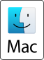

---
hide:
  - navigation
  - toc
author:
  - Olivier Friard
title: BORIS for MacOS
---

{width="72px"}

Please acknowledge and cite the use of this software and its authors when results are used in publications or published elsewhere:



# General information

The author would like to thank [dsanmiguel](https://github.com/dsanmiguel) for his decisive work on making BORIS run on macOS.

Please report any issues or caveats related to the installation or use of BORIS on macOS.
See the [how to report a bug](report_a_bug.md) page

## How to install and run on macOS

### Install **Homebrew** if not already installed from [https://brew.sh](https://brew.sh)

Homebrew is "The Missing Package Manager for macOS" and has more then 45K stars on [GitHub](https://github.com/Homebrew/brew).

### Install the BORIS dependencies with Homebrew

[FFmpeg](https://ffmpeg.org/) is "a complete, cross-platform solution to record, convert and stream audio and video."

[mpv](https://mpv.io/) is "a free, open source, and cross-platform media player".

Open a macOS Terminal and type (or paste): (1)
{ .annotate }

1.  If you do not know how to open a terminal,
    see [macOS terminal](https://support.apple.com/guide/terminal/open-or-quit-terminal-apd5265185d-f365-44cb-8b09-71a064a42125/mac)

`brew install mpv ffmpeg pkg-config cmake gfortran openblas`

### Install the uv Python package and project manager from [Astral](https://docs.astral.sh/uv/getting-started/installation/)

[uv](https://docs.astral.sh/uv/) is an "An extremely fast Python package and project manager, written in Rust" and has more than 70K stars on [GitHub](https://github.com/astral-sh/uv)

To activate uv, **close the terminal and reopen it**

### Install and launch BORIS with uvx

In the macOS Terminal type (or paste): (1)
{ .annotate }

1.  If you do not know how to open a terminal,
    see [macOS terminal](https://support.apple.com/guide/terminal/open-or-quit-terminal-apd5265185d-f365-44cb-8b09-71a064a42125/mac)

```
export LDFLAGS="-L/usr/local/opt/openblas/lib"
export CPPFLAGS="-I/usr/local/opt/openblas/include"
export PKG_CONFIG_PATH="/usr/local/opt/openblas/lib/pkgconfig"
export CMAKE_PREFIX_PATH="/usr/local/opt/openblas"

uvx --python 3.13 boris@latest
```

The next time you want to launch BORIS just open a terminal and type the command:

`uvx --python 3.13 boris@latest`

To launch a specific version of BORIS:

`uvx --python 3.13 boris==10.0.2`

###

> BORIS was successfully tested on:
>
> - Mac min (Apple M2 Pro) with Sequoia 15.3.2
>
> - MacBook Pro (2.3 GHz 8-core Intel core i9) with Tahoe 26.0.1

## Some points of reflection on the use of the macOS operating system in research

- [Apple Removes Ability to Run Unsigned Apps in macOS 15.1](https://lunduke.locals.com/post/6304352/apple-removes-ability-to-run-unsigned-apps-in-macos-15-1)

- [EU to Apple: "Let Users Choose Their Software"; Apple: "Nah"](https://www.eff.org/deeplinks/2024/10/eu-apple-let-users-choose-their-software-apple-nah)

- ["Sideloading is a cyber criminal’s best friend"](https://www.theverge.com/2021/11/3/22761724/apple-craig-federighi-ios-sideloading-web-summit-2021-european-commission-digital-markets-act)
